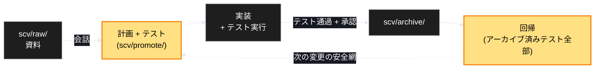
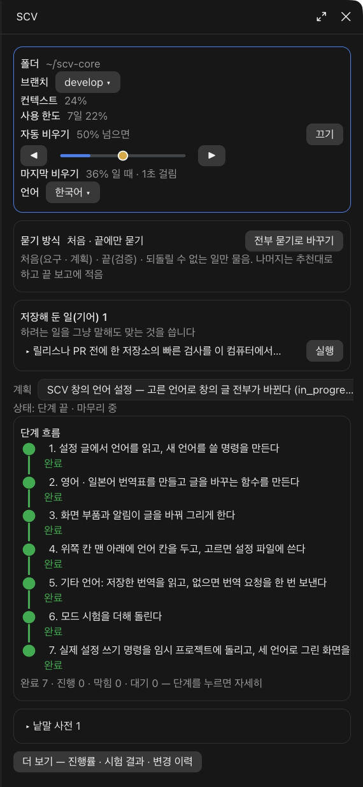
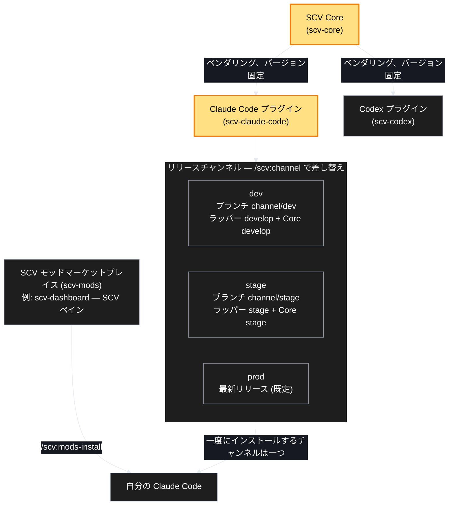

<div align="center">


<h1>SCV</h1>

<p><b>Standard · Cowork · Verify</b></p>

<p><b>チームのための Claude Code プラグイン。<br>
すべての変更は計画とテストとともに出荷され — テストは永遠に回り続けます。</b></p>

<p>
<a href="https://github.com/wookiya1364/scv-claude-code/releases/latest"></a>


</p>


</div>

---

> **Languages**: [English](./README.md) · [한국어](./README.ko.md) · 日本語

## SCV とは

変更の話をする → SCV が実行可能なテストつきの計画へ磨き上げる → 実装する →
証跡を PR に添付する → 計画をアーカイブする。アーカイブされたテストはすべて
回帰スイートに蓄積され、以後のあらゆる変更を検査します。半年後、誰も覚えて
いないテストが故障を捕まえます。

## インストール

```bash
/plugin marketplace add https://github.com/wookiya1364/scv-claude-code
/plugin install scv@scv-claude-code
```

- **macOS**: `brew install bash` を一度 (SCV スクリプトは bash 4+ が必要; システム bash はそのまま)。
- **Linux / WSL**: 何も不要。**Windows ネイティブ**: 非対応 — WSL か Git Bash を。
- 推奨 CLI: `git`, `curl`, `jq`, `gh` (または `glab`)。足りなければ SCV が知らせます。

**更新**はコマンド一つで行えます — ターミナルのセッションでも Claude アプリでも同じです:

```bash
/scv:update
```

SCV とインストール済みの SCV モッドをすべて更新し、更新前後のバージョンを伝えます。更新は新しい
セッションを開くと反映されます。更新後、各プロジェクトは最初のアクションで SCV のファイルを自ら更新し、
更新したことを伝えます。「SCV は最新?」と尋ねるだけなら確認のみで、何も変更しません。
(ターミナルのセッションでは標準のコマンド二つでも行えます: `/plugin marketplace update scv-claude-code`、続けて `/reload-plugins`。)

SCV モッドは SCV に足す小さなプラグインです — 今はデスクトップアプリの SCV ペイン
[`scv-dashboard`](#ダッシュボード) が一つあります。`/scv:mods` が更新して一覧を表示し、
`/scv:mods-install`・`/scv:mods-remove` で一つを選んでインストール・削除します。引数はありません。

## 使い方

**普通に話しかけるだけ。** 覚えるコマンドはありません — SCV が会話に自ら加わります:

```text
あなた: 決済画面に払い戻しボタンを付けたい。
SCV:    (会話モードに入り、目標 / 範囲 / 受け入れ基準を質問し、
         十分になったら計画とテストの下書きを提案)
```

作りたいことを話せば計画に磨き上げ、次に何をすべきか聞けばプロジェクトを
診断し、「去年の払い戻しはどう処理した?」と聞けば過去の作業を探します —
タイトルだけでなく、計画の本文、テスト、決定、会話まで調べます。`/scv:help`
は同じことを明示的に行う入口で、`scv/scv_settings.json` の
`SCV_ALWAYS_ON=off` でコマンド専用の動作に戻せます。

SCV は毎ターン、次のことも行います:

- **やさしい言葉で答えます** — 一、二文の結論が先、次に例を一つ、コードの値は
  聞かれたときだけ (`SCV_PLAIN_LANGUAGE`);
- **モデルの提供元が勧めるやり方でモデルに依頼します** — 使っているモデルの公式
  プロンプティングガイドを同梱し、依頼をそのガイドの言うとおりに書き直して、
  答えの先頭に引用します。そのターンが登録されるまで
  ファイルは書きません (`SCV_MODEL_PROMPTING`);
- **中断したところから続けます** — `/clear`、圧縮、再開のあとに、進行中の計画、
  最近の決定、未決事項、進行中の会話を載せ直します (`SCV_RESUME_RECAP`);
- **実物を動かして見せます** — 成果物が変わるターンでは、最初に動く瞬間に最小の
  ものを実際に実行し、その結果 (コマンド出力 · 画面 · 関数の結果) をそのまま見せ、
  続けるか直すかを選択ウィンドウで聞きます。何も変わらなければ「成果物の変化なし」と
  書き、何も聞きません (`SCV_SHOW_REAL`);
- **確認したことと、していないことを分けます** — ツールを使ったターンの最後の報告に、
  確認したこと · 確認できなかったこと · 代わりに決めたことを分けて書きます
  (`SCV_FINISH_REPORT`);
- **尋ねる場所を選べます** — 最初 (要件 · 計画の概要) と最後 (検証)、取り消せない
  操作の前だけ尋ねるようにすると、残りはおすすめどおりに決めて最後の報告に残します
  (`/scv:ask-mode`, `SCV_ASK_MODE`);
- **繰り返しに気づきます** — 似た依頼が繰り返されるとギア (再利用できる作業単位) に
  するかを尋ね、合うギアがすでにあれば知らせます (`/scv:gear`, `SCV_GEAR_DETECT`);
- **決めた語で話します** — 用語辞書に書いた避けたい語を、その活用形まで決めた語に
  言い換えます (`/scv:words`, `SCV_WORDS`)。

会話の裏では、ひとつのループがすべてを回しています:




## ダッシュボード

Claude デスクトップアプリでは、チャットの横に **SCV ペイン**が開きます。計画がどこまで
進んだか、Claude が今何をしているか、何があなたを待っているかを、会話を読まずに
見られます。ペインは別のモッド `scv-dashboard` です。

<p align="center"></p>

<p align="center"><sub>実際のセッションの画面 (韓国語表示) — ペインは英語と日本語でも表示できます。</sub></p>

**インストール** — 引数なしで入力し、一覧から `scv-dashboard` を選びます:

```bash
/scv:mods-install
```

そのあと新しいセッションを開くか `/reload-plugins` を実行します。シェルでは
`claude plugin install scv-dashboard --marketplace wookiya1364/scv-mods`、
デスクトップアプリでは入力欄の横の **+** → Plugins → Add marketplace に
`wookiya1364/scv-mods` を入れても同じです。更新は `/scv:update` が SCV と一緒に行います。

**使い方** — ペインはセッションを開くと自動で開きます。閉じたときは `/scv-dashboard` で
もう一度開きます。

| 見たいこと · したいこと | ペインで |
|---|---|
| どこまで進んだか | 一番上の一行要約 · ステップの流れ |
| 次にすること | ボタンを押すとコマンドが入力欄に |
| ステップがしたこと | ステップを押す — 画像 · 動画の証拠 |
| Claude が今していること | ツール · 経過時間 · 裏で動く作業 |
| あなたを待っているもの | 返事 · 許可 · 失敗したテストのカードと通知 |
| 残りの余裕 | コンテキスト · 利用上限 |
| ギアを動かす | ギアの行の [実行] — モデルを通さない |
| 尋ね方を切り替える | ボタン一つ |
| 長い会話を短くする | 基準 (%) を超えると自動でクリア |
| 用語辞書 | 追加 · 修正 · 削除 |
| 言語 | 한국어 · English · 日本語 · 自分で入力 |
| ブランチを切り替える | ブランチ名を押す |
| 別のコンピューターで見る | `/scv-mirror <アドレス>` |

- ペインはデスクトップアプリで開いたセッションにだけ描かれます。ターミナルとリモート
  画面 (claude.ai · スマートフォン) にはペインがありません — 別のコンピューターでは、
  そのコンピューターのアプリで `/scv-mirror` を使います。
- 会話を自動でクリアしたあとは、直前の会話とタスク一覧をもう一度表示します。
- すべての機能 · ミラーの使い方 · 版ごとの変更:
  [scv-mods](https://github.com/wookiya1364/scv-mods#readme)。

## 得られるもの

| チームの問題 | SCV がすること | どこで |
|---|---|---|
| AI の差分を自分で動かすまで信用できない | PR にテスト動画が付く | `/scv:work` |
| チケット・PR・チャットで説明がばらばら | 計画書一つから PR・報告を作る | `PLAN.md` |
| 決定がセッションと共に消える | 決定ログに自動で残る | `scv/DECISIONS.md` |
| 古い機能が黙って壊れる | 過去の計画のテストを再実行 | `/scv:regression` |
| 計画書が文字の壁 | 番号付きの図一枚 | `/scv:deck` · `FEATURE_ARCHITECTURE.md` |
| 変更がどこまで届くか分からない | 一緒に変わるファイルを示す | `SCV_GRAPH` · `SCV_GRAFT` |
| 「前に試した?」 | 過去の計画・会話まで探す | [過去の作業検索](vendor/scv-core/core/protocols/help/archive-search.md) |
| 同じ関数をまた作る | まず関数辞書を探す | [純粋関数の辞書](vendor/scv-core/core/contracts/purity.md) |
| プロセスが回っているか分からない | 記録を数字で見せる | `metrics.sh` |

## 設定

ファイルはひとつ: `scv/scv_settings.json` — 全キーが既定値・説明 (`_doc`)
つきで自動生成されるので、開けば何が設定できるか全部見えます。秘密 (トークン、
チャンネル ID) は git-ignore される別ファイルへ。`.env` は読みも書きもしません。

| キー | 既定 | 役割 |
|---|---|---|
| `SCV_ALWAYS_ON` | `on` | 自由会話にも SCV が加わる; `off` = コマンド専用 |
| `SCV_PLAIN_LANGUAGE` | `on` | やさしい言葉優先の答えの形 (+毎ターンのリマインド); `off` で停止 |
| `SCV_MODEL_PROMPTING` | `on` | モデル別プロンプティング: モデルのガイドを読み、毎回の依頼を照合 · 登録 |
| `SCV_RESUME_RECAP` | `on` | `/clear` · 圧縮 · 再開のあとに進捗を載せ直す |
| `SCV_SHOW_REAL` | `on` | 成果物が変わると最小のものを実際に動かして結果を見せる; `off` で止める |
| `SCV_FINISH_REPORT` | `on` | 最後の報告に確認したこと · できなかったこと · 代わりに決めたことを書く |
| `SCV_ASK_MODE` | `all` | `all` 毎回尋ねる · `ends` 最初と最後だけ尋ねる |
| `SCV_GEAR_DETECT` | `on` | 繰り返される依頼に気づいてギアを勧める |
| `SCV_WORDS` | `on` | 用語辞書の避けたい語を決めた語に言い換える |
| `SCV_CATALOG_SOURCE` | `on` | コードのコメントを純粋関数辞書へ移し、新しいコメントを止める |
| `SCV_BACKGROUND_FIRST` | `on` | 長くかかる作業は裏で動かす |
| `SCV_DELEGATE_EFFORT` | `off` | 深い質問をバックグラウンドの調査担当へ渡す; 報告は `scv/raw/` に |
| `SCV_LANG` | 自動 | 出力言語: `english` · `korean` · `japanese` |
| `NOTIFIER_PROVIDER` | オフ | チームレポート先: `slack` か `discord` |

その他のキーと既定値:
[`scv_settings.example.json`](vendor/scv-core/core/template/scv/scv_settings.example.json)。
スクリプト経由で書けば、秘密は正しいファイルへ自動で振り分けられます:

```bash
CORE="$HOME/.claude/plugins/cache/scv-claude-code/scv/<version>/vendor/scv-core/core"
bash "$CORE/scripts/settings-set.sh" NOTIFIER_PROVIDER=slack
bash "$CORE/scripts/settings-set.sh" SLACK_BOT_TOKEN=xoxb-...   # → secret ファイル
bash "$CORE/scripts/metrics.sh"                                 # プロセスの数字
```

## コマンド一覧

この表は覚えなくて構いません — 会話が自動でルーティングします。明示的に使うなら:

| コマンド | 役割 |
|---|---|
| `/scv:help` | プロジェクト診断 · アイデアの具体化 · 過去の作業の検索 |
| `/scv:status` | 進行中のもの: raw の変化、アクティブな計画、epic、handoff |
| `/scv:promote` | 資料 → 計画フォルダ (`PLAN.md` + `TESTS.md` + 図) |
| `/scv:work <slug>` | 実装 · テスト · アーカイブ · 証跡つき PR |
| `/scv:codegen <slug>` | TDD-first 変種: テストがコードを導く、Red → Green |
| `/scv:regression` | アーカイブされた全計画のテストをひとつのスイートで実行 |
| `/scv:deck [<md>]` | 計画 → 番号付き画面設計書; Markdown → 企画書 · スライド |
| `/scv:report` | フェーズ結果を Slack/Discord へ証跡つきで報告 |
| `/scv:sync` | SCV テンプレート更新 + コード↔計画のドリフト検知 |
| `/scv:routine [<name>]` | 1 ファイルのメンテナンスルーチンを実行 |
| `/scv:workspace` · `/scv:handoff` | マルチレポ: アンブレラ構成 · 他リポジトリ作業の宣言 |
| `/scv:update` · `/scv:set-models` · `/scv:install-deps` | プラグイン・モッド更新 · モデルポリシー · CLI 依存 |
| `/scv:mods` · `/scv:mods-install` · `/scv:mods-remove` | SCV モッド更新 + 一覧 · 一つインストール · 一つ削除 |
| `/scv:channel` | SCV 開発·ステージング·本番の切替 — リリース前に新作業を確認 |
| `/scv:ask-mode` | 最初と最後だけ尋ねる ↔ 毎回尋ねる |
| `/scv:catalog-source` | コードにコメントを置かず純粋関数辞書を原本に |
| `/scv:gear` | ギアの実行・作成 — `scv/gears/` の再利用できる作業単位 |
| `/scv:words` | 用語辞書 — 避けたい語とその活用形を決めた語に言い換える |

## ガードレール

ワークフローを正直に保つ三層:

- **セッション内**: `PreToolUse` ガードが、手作りの計画ファイルと `scv/` 外への
  書き込みを拒否します — セッションで SCV アクションが一度でも動くまで
  (`/scv:status` で十分)。内部エラー時は開く側へ、SCV 未導入プロジェクトでは
  不活性。停止: プロセス環境変数 `SCV_GUARD=off`。
- **毎ターン**: そのターンの書き直した依頼が登録されるまで
  ファイルの書き込みを待たせ、書き直した依頼なしで終わるターンは、それを
  加えるよう一度止めます (`SCV_MODEL_PROMPTING=off` で両方とも停止)。
- **マージ時**: CI ゲートが、アーカイブ済み計画のないコード変更 PR を拒否し
  (`[no-plan: <理由>]` で例外宣言)、手書きで書き換えられたベンダーコアを拒否
  します (`[manual-vendor: <理由>]`)。

契約: [`vendor/scv-core/core/contracts/guard.md`](vendor/scv-core/core/contracts/guard.md)。

## マルチレポ

既定は単一リポジトリ。FE/BE/サービスに分かれたシステムはアンブレラひとつの
下に束ねられます: `/scv:workspace` で作成/参加し、`/scv:handoff` で「あの
リポジトリの対応作業が必要」を相手が見る場所に宣言します。リンクを外せば
移行なしで単独動作に戻ります。モジュール別 `scv/` を持つモノレポは先頭引数で
モジュール指定: `/scv:status FE`。

## 哲学 — Standard · Cowork · Verify

- **Standard**: 標準はワークフローであってスナップショット文書ではない。決定は古びる文書ではなく追記専用ログに残る。
- **Cowork**: 計画は対話から生まれ、節ごとに承認される — モデルの推測ではなく、あなたが言ったこと。
- **Verify**: テストは実行可能で、アーカイブされたテストは永遠に回る。失敗は明示的に分類する — 黙って飛ばすことはない。

<details>
<summary><b>参考 — 導入後のプロジェクト構造</b></summary>

```
my-project/
├── CLAUDE.md              # あなたのもの — SCV は触れない
├── scv/                   # SCV の持ち物はすべてこの下
│   ├── SCV.md PROMOTE.md REPORTING.md
│   ├── DECISIONS.md       # 追記専用の決定ログ
│   ├── conversations/     # 計画になった対話 (コミットされる)
│   ├── journal/           # 全プロンプト、フックが記録 (既定 gitignore)
│   ├── promote/  archive/  raw/  routines/
│   ├── scv_settings.json         # 設定 (自動生成、コミットされる)
│   └── scv_settings.secret.json  # トークン (自動生成、git-ignore)
└── .gitignore             # SCV 規則が append される
```

導入は非破壊的です: 既存のルートファイルはそのまま、SCV が加えるのは `scv/`
ディレクトリひとつと `.gitignore` 数行だけ。このリポジトリの `demo/` は
README の GIF 制作用で、プラグイン利用者には不要です。

</details>

## アーキテクチャ

共有動作は、チェックサム・バージョン固定された
[scv-core](https://github.com/wookiya1364/scv-core) リリースをプラグイン内に
ベンダリングしたものから来ます — 実行時に何も取得しません。

このリポジトリは Claude Code アダプターです:

- スラッシュコマンド、フック登録、インストール/更新 UX
- バックグラウンド調査エージェント
- `prompting/` 以下のモデルプロンプティングガイド — 公式ガイドの原文そのまま;
  写しごとに出典 · 日付 · 著作権の行があるかを CI が検査

フックの役割:

- フックの stdout が毎ターン、ルーティング、プロジェクト診断、プロンプティング
  ブロック、やさしい言葉のリマインドを届けます。
- セッション開始フックが再開サマリーを載せ直します。
- 終了フックが答えの形とそのターンの登録を検査します。
- ジャーナルフックは書き込み前のリダクションを経て会話を記録します。

部品のつながり — Core はホストごとのプラグインにベンダリングされ、チャンネルが
インストールするビルドを選び、モッドは別のマーケットプレイスから来ます:




## コントリビューション

PR 前に `tests/run-dry.sh`。ブランチフローは `develop → stage → main`;
リリースは `gh workflow run promote.yml` — [docs/RELEASING.md](docs/RELEASING.md)
参照。履歴は [releases](https://github.com/wookiya1364/scv-claude-code/releases) に。

---

**License**: [MIT](./LICENSE) © 2026 wookiya1364
