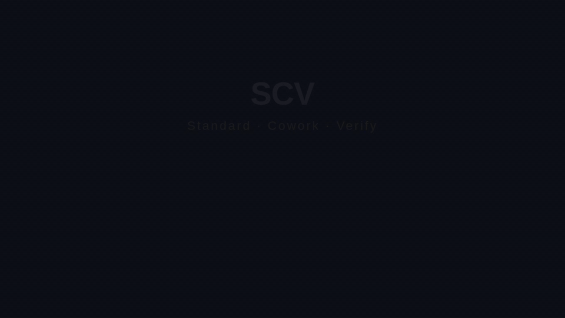
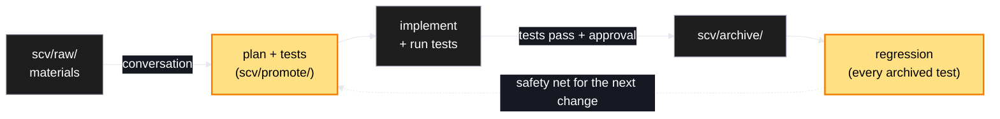
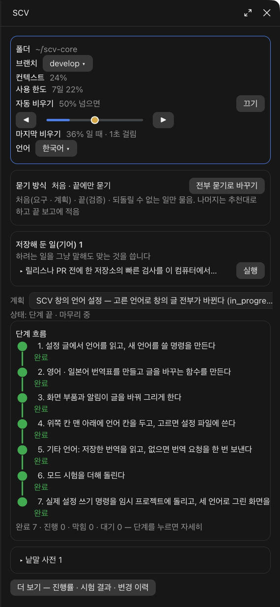
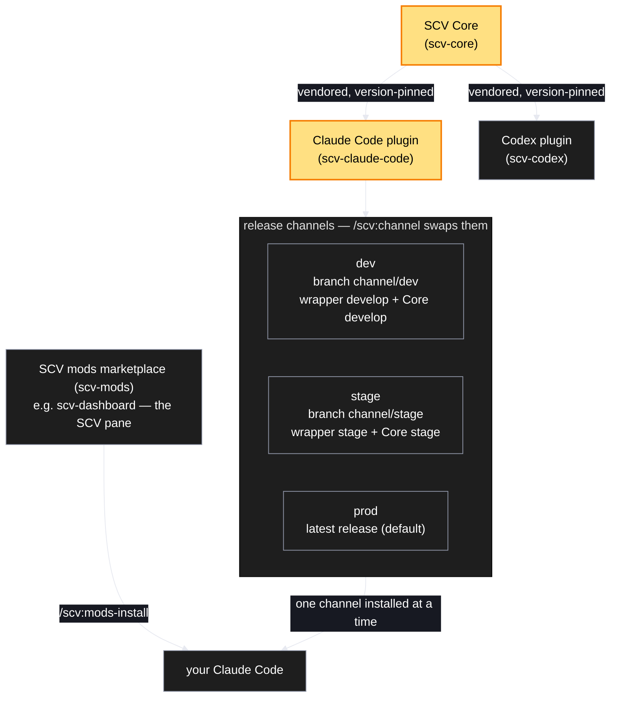

<div align="center">


<h1>SCV</h1>

<p><b>Standard · Cowork · Verify</b></p>

<p><b>A Claude Code plugin for teams.<br>
Every change ships with a plan and tests — and the tests run forever.</b></p>

<p>
<a href="https://github.com/wookiya1364/scv-claude-code/releases/latest"></a>


</p>



</div>

---

> **Languages**: English · [한국어](./README.ko.md) · [日本語](./README.ja.md)

## What is SCV

Talk about a change → SCV refines it into a plan with executable tests →
implements it → attaches the evidence to the PR → archives the plan. Every
archived test joins a regression suite that runs against every future change.
Six months later, a test nobody remembers still catches the break.

## Install

```bash
/plugin marketplace add https://github.com/wookiya1364/scv-claude-code
/plugin install scv@scv-claude-code
```

- **macOS**: `brew install bash` once (SCV scripts need bash 4+; system bash stays untouched).
- **Linux / WSL**: nothing to do. **Windows native**: unsupported — use WSL or Git Bash.
- Recommended CLIs: `git`, `curl`, `jq`, `gh` (or `glab`). SCV tells you if one is missing.

**Update** to the latest release with one command — in a terminal session or in the Claude app:

```bash
/scv:update
```

It updates SCV and every installed SCV mod, then tells you the versions before and after. Open a new
session for the update to take effect. After an update, each project refreshes its SCV files on the
first action — and says so. Asking "is SCV current?" only checks; it changes nothing.
(In a terminal session the two built-in commands also work: `/plugin marketplace update scv-claude-code`, then `/reload-plugins`.)

SCV mods are small plugins that add to SCV — today there is one, [`scv-dashboard`](#dashboard),
the SCV pane in the desktop app. `/scv:mods` updates them and lists them,
`/scv:mods-install` and `/scv:mods-remove` let you pick one. No arguments.

## How you use it

**Just talk.** No command to memorize — SCV joins the conversation by itself:

```text
You:  I want to add a refund button to checkout.
SCV:  (enters conversation mode, asks goal / scope / acceptance,
       then offers to draft the plan and tests)
```

Say what you want to build and SCV refines it into a plan. Ask what to do next
and it diagnoses the project. Ask "how did we handle refunds last year?" and
it searches past work — plan bodies, tests, decisions, and conversations, not
only titles. `/scv:help` does the same thing explicitly, and
`SCV_ALWAYS_ON=off` in `scv/scv_settings.json` restores command-only behavior.

Every turn, SCV also:

- **answers in plain language** — a one- or two-sentence conclusion first,
  then one example, code values only when you ask (`SCV_PLAIN_LANGUAGE`);
- **prompts your model the way its vendor recommends** — SCV ships the
  official prompting guide for the model you run, rewrites each request the
  way that guide says, and quotes the rewritten request at the top of the
  answer. File writes wait until the turn is registered
  (`SCV_MODEL_PROMPTING`);
- **picks up where you left off** — after `/clear`, compaction, or a resume,
  it re-injects active plans, recent decisions, open items, and the active
  conversation (`SCV_RESUME_RECAP`);
- **shows the real thing** — when a turn changes the deliverable, at the first
  moment it runs SCV runs the smallest real thing, shows its actual output
  (command output, screen, function result), and asks continue / fix with the
  choice tool; when nothing changes it writes "no change to the deliverable" and
  asks nothing (`SCV_SHOW_REAL`);
- **separates what it checked from what it did not** — the closing report of a
  turn that used tools lists what was verified, what was not, and what SCV
  decided for you (`SCV_FINISH_REPORT`);
- **asks only where you want it to** — set it to ask at the start (requirements,
  plan outline), at the end (verification) and before anything irreversible; it
  takes its own recommendation for the rest and lists it in the closing report
  (`/scv:ask-mode`, `SCV_ASK_MODE`);
- **notices repetition** — when a similar request comes back, it asks whether
  to make it a gear (a reusable work unit), and points to a gear that already
  fits (`/scv:gear`, `SCV_GEAR_DETECT`);
- **uses your words** — the words your word dictionary says to avoid are
  replaced with the ones you chose, inflections included (`/scv:words`,
  `SCV_WORDS`).

Behind the conversation, one loop runs everything:




## Dashboard

In the Claude desktop app an **SCV pane** opens beside the chat. It shows where
the plan stands, what Claude is doing now, and what waits on you — without
reading the conversation. The pane is a separate mod, `scv-dashboard`.

<p align="center"></p>

<p align="center"><sub>A real session, shown in Korean — the pane also speaks English and Japanese.</sub></p>

**Install** — type it with no argument and pick `scv-dashboard` from the list:

```bash
/scv:mods-install
```

Then open a new session or run `/reload-plugins`. From a shell,
`claude plugin install scv-dashboard --marketplace wookiya1364/scv-mods` does the same;
in the desktop app, click **+** next to the prompt box → Plugins → Add marketplace
with `wookiya1364/scv-mods`. `/scv:update` updates it together with SCV.

**Use** — the pane opens by itself when a session starts. If you closed it,
`/scv-dashboard` opens it again.

| To see · to do | In the pane |
|---|---|
| Where the work stands | one-line summary on top · the step flow |
| The next thing to do | a button puts its command in the prompt box |
| What a step did | press the step — picture · video evidence |
| What Claude is doing now | tool · elapsed time · background work |
| What waits on you | cards and alerts: answer · permission · failed test |
| Room left | context · usage limits |
| Run a gear | [Run] on the gear's line — no model call |
| Switch the ask mode | one button |
| Shorten a long conversation | clears by itself past a threshold (%) |
| Word dictionary | add · edit · delete |
| Language | 한국어 · English · 日本語 · type another |
| Switch branch | press the branch name |
| See it on another computer | `/scv-mirror <address>` |

- The pane is drawn only in a session opened in the desktop app. The terminal and
  remote views (claude.ai, the phone) have no pane — on another computer, use
  `/scv-mirror` in that computer's own app.
- After an automatic clear it shows the last exchanges and the task list again.
- Every feature, how to mirror, and what each version changed:
  [scv-mods](https://github.com/wookiya1364/scv-mods#readme).

## What you get

| Team problem | What SCV does | Where |
|---|---|---|
| You run an AI diff before trusting it | The PR arrives with a test video | `/scv:work` |
| Ticket · PR · chat tell it differently | One plan feeds the PR and reports | `PLAN.md` |
| Decisions vanish with the session | They land in a decision log | `scv/DECISIONS.md` |
| Old features silently break | Past plans' tests run again | `/scv:regression` |
| Plans read as a wall of text | One numbered picture per plan | `/scv:deck` · `FEATURE_ARCHITECTURE.md` |
| Unclear what a change will touch | Shows files that change together | `SCV_GRAPH` · `SCV_GRAFT` |
| "Did we already try this?" | Searches past plans and talks | [archive search](vendor/scv-core/core/protocols/help/archive-search.md) |
| The same helper gets rewritten | Checks the function catalog first | [pure-function catalog](vendor/scv-core/core/contracts/purity.md) |
| No idea if the process works | Turns records into numbers | `metrics.sh` |

## Settings

One file: `scv/scv_settings.json` — created automatically with every key
present and documented (`_doc`), so you can see what's settable by opening it.
Secrets (tokens, channel IDs) go to a separate git-ignored file. Your `.env`
is never read or written.

| Key | Default | What it does |
|---|---|---|
| `SCV_ALWAYS_ON` | `on` | SCV joins free conversation; `off` = commands only |
| `SCV_PLAIN_LANGUAGE` | `on` | plain-first answer shape (+ per-turn reminder); `off` silences |
| `SCV_MODEL_PROMPTING` | `on` | per-model guide; compare and register every request |
| `SCV_RESUME_RECAP` | `on` | re-inject progress after `/clear`, compaction, or resume |
| `SCV_SHOW_REAL` | `on` | show a real run when the deliverable changes; `off` silences |
| `SCV_FINISH_REPORT` | `on` | closing report: verified · not verified · decided for you |
| `SCV_ASK_MODE` | `all` | `all` asks every time; `ends` only at the start and the end |
| `SCV_GEAR_DETECT` | `on` | notice repeated requests and suggest a gear |
| `SCV_WORDS` | `on` | replace the word dictionary's avoided words |
| `SCV_CATALOG_SOURCE` | `on` | code comments move to the function catalog; no new ones |
| `SCV_BACKGROUND_FIRST` | `on` | long-running work goes to the background |
| `SCV_DELEGATE_EFFORT` | `off` | deep questions → background investigator; report in `scv/raw/` |
| `SCV_LANG` | auto | output language: `english` · `korean` · `japanese` |
| `NOTIFIER_PROVIDER` | off | `slack` or `discord` for team reports |

Every other key and its default:
[`scv_settings.example.json`](vendor/scv-core/core/template/scv/scv_settings.example.json).
Write through the script — it routes secrets to the right file automatically:

```bash
CORE="$HOME/.claude/plugins/cache/scv-claude-code/scv/<version>/vendor/scv-core/core"
bash "$CORE/scripts/settings-set.sh" NOTIFIER_PROVIDER=slack
bash "$CORE/scripts/settings-set.sh" SLACK_BOT_TOKEN=xoxb-...   # → secret file
bash "$CORE/scripts/metrics.sh"                                 # process numbers
```

## Commands

You never need this table — conversation routes for you. For explicit control:

| Command | Does |
|---|---|
| `/scv:help` | Diagnose the project · refine an idea · search past work |
| `/scv:status` | What's in flight: raw changes, active plans, epics, handoffs |
| `/scv:promote` | Materials → plan folder (`PLAN.md` + `TESTS.md` + diagrams) |
| `/scv:work <slug>` | Implement · run tests · archive · PR with evidence |
| `/scv:codegen <slug>` | TDD-first variant: tests drive the code, Red → Green |
| `/scv:regression` | Run every archived plan's tests as one suite |
| `/scv:deck [<md>]` | Plan → numbered screen spec; any md → planning doc · slides |
| `/scv:report` | Post a phase result to Slack/Discord with artifacts |
| `/scv:sync` | Refresh SCV templates + detect code↔plan drift |
| `/scv:routine [<name>]` | Run a one-file maintenance routine |
| `/scv:workspace` · `/scv:handoff` | Multi-repo: umbrella setup · cross-repo work declaration |
| `/scv:update` · `/scv:set-models` · `/scv:install-deps` | Plugin + mods update · model policy · CLI deps |
| `/scv:mods` · `/scv:mods-install` · `/scv:mods-remove` | Update + list SCV mods · install one · remove one |
| `/scv:channel` | Switch SCV dev · stage · prod — try new work pre-release |
| `/scv:ask-mode` | Ask only at the start and the end, or everywhere |
| `/scv:catalog-source` | No comments in code — the catalog is the source |
| `/scv:gear` | Run or make gears — reusable work units in `scv/gears/` |
| `/scv:words` | Word dictionary — say B instead of A, inflections included |

## Guardrails

Three layers keep the workflow honest:

- **In-session**: a `PreToolUse` guard refuses hand-created plan files and
  writes outside `scv/` until any SCV action has run in the session
  (`/scv:status` is enough). Fails open on internal errors; inert where SCV
  isn't adopted. Off switch: `SCV_GUARD=off` in the process environment.
- **Every turn**: file writes wait until the turn's rewritten request is
  registered, and a turn that ends without the rewritten
  request is stopped once so it can be added (`SCV_MODEL_PROMPTING=off`
  turns both off).
- **At merge**: CI gates deny a PR that changes code without an archived plan
  (`[no-plan: <reason>]` declares an exception) and a hand-rewritten vendored
  core (`[manual-vendor: <reason>]`).

Contract: [`vendor/scv-core/core/contracts/guard.md`](vendor/scv-core/core/contracts/guard.md).

## Multi-repo

Single-repo by default. Systems spanning FE/BE/service repos can nest under
one umbrella: `/scv:workspace` joins or creates it, `/scv:handoff` declares
"that repo needs corresponding work" where the other repo will see it.
Detaching restores standalone behavior with zero migration. Monorepos with
per-module `scv/` target a module by leading argument: `/scv:status FE`.

## Philosophy — Standard · Cowork · Verify

- **Standard**: the standard is the workflow, not snapshot docs. Decisions live in an append-only log, not stale documents.
- **Cowork**: plans come from dialog, approved per-section — what you said, not what the model guessed.
- **Verify**: tests are executable, and archived tests keep running forever. Failures triage explicitly — never silently skipped.

<details>
<summary><b>Reference — project layout after adoption</b></summary>

```
my-project/
├── CLAUDE.md              # yours — SCV never touches it
├── scv/                   # everything SCV owns lives here
│   ├── SCV.md PROMOTE.md REPORTING.md
│   ├── DECISIONS.md       # append-only decision log
│   ├── conversations/     # dialogs that became plans (committed)
│   ├── journal/           # every prompt, hook-fed (gitignored by default)
│   ├── promote/  archive/  raw/  routines/
│   ├── scv_settings.json         # settings (auto-created, committed)
│   └── scv_settings.secret.json  # tokens (auto-created, git-ignored)
└── .gitignore             # SCV rules appended
```

Adoption is non-destructive: existing root files stay intact; one `scv/`
directory and two `.gitignore` lines are all SCV adds. The `demo/` directory
in this repository only builds the README GIFs — plugin users never need it.

</details>

## Architecture

Shared behavior comes from a checksummed, version-pinned
[scv-core](https://github.com/wookiya1364/scv-core) release vendored into this
plugin — nothing is fetched at runtime.

This repository is the Claude Code adapter:

- slash commands, hooks registration, install/update UX
- the background investigator agent
- the model prompting guides under `prompting/` — verbatim copies of the
  official guides; CI checks that each copy carries its source, date and
  copyright lines

What the hooks do:

- Hook stdout delivers the per-turn routing, the project diagnosis, the
  prompting block, and the plain-language reminder.
- The session-start hook re-injects the recap.
- The stop hook checks the answer's shape and the turn's registration.
- The journal hooks capture conversation with redaction before anything hits
  disk.

How the pieces fit — Core is vendored into each host's plugin, the channel
picks which build you install, and mods come from their own marketplace:




## Contributing

Run `tests/run-dry.sh` before PRs. Branch flow `develop → stage → main`;
releases go through `gh workflow run promote.yml` —
see [docs/RELEASING.md](docs/RELEASING.md). History lives in the
[releases](https://github.com/wookiya1364/scv-claude-code/releases).

---

**License**: [MIT](./LICENSE) © 2026 wookiya1364
